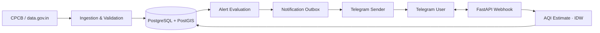

 

---

## 🧠 About Me

I'm a **Software Engineer** with around **4 years of experience** building distributed backend services for **logistics and platform operations**. I design systems for production load, with a focus on **microservices, event-driven architecture, clean REST APIs, and observability**, and I look for ways to cut cloud cost without cutting quality.

| | |
|---|---|
| 💼 **Currently** | Software Engineer at **[Delhivery](https://www.delhivery.com/)**, Gurugram (Oct 2024 – Present) |
| 🧩 **Previously** | Software Engineer at **[Pine Labs](https://www.pinelabs.com/)**, Bengaluru (Nov 2022 – Sep 2024) |
| 🚀 **Now building** | **Hyperlocal Air Quality Alerts** for Delhi NCR |
| 🎓 **Education** | B.Tech in Computer Science, Madan Mohan Malaviya University of Technology, Gorakhpur |
| 🏅 **Certifications** | Generative AI: Introduction and Applications · Introduction to Artificial Intelligence (AI) |

---

## ⚡ Impact at a Glance

| 🚚 Throughput | 💰 Cost Efficiency | 📦 Migration Scale | 🔍 Observability |
|:---:|:---:|:---:|:---:|
| **18k+ req/min** after container migration | **~40%** better price-performance | **10+ functions & 20+ apps** modernised | **CubeAPM + Coralogix** across migrated services |

---

## 🛠️ Tech Stack

**Languages:**    

**Backend & Frameworks:**      

**Frontend & AI:**    

**Messaging & Data:**        

**Cloud, DevOps & Observability:**       

**Architecture:** Microservices · Event-Driven Architecture · System Design · REST API Design · JWT Authentication

---

## 🔭 Featured Projects

### 🌫️ Hyperlocal Air Quality Alerts &nbsp;`In Active Development`

A Python and FastAPI service that estimates air quality near a saved location and is being built to send threshold alerts over Telegram.

- 📍 **Location-based AQI** estimates from nearby CPCB monitoring stations, weighted by distance (inverse-distance weighting)
- 🧮 **Indian PM2.5 AQI** calculation with freshness and coverage checks, so stale or sparse data is never shown as current
- 🔔 **Alert state machine** with explicit opt-in, threshold/clear hysteresis, and an idempotent notification outbox
- 🗺️ **PostgreSQL + PostGIS** for spatial station lookup
- 🤖 **Telegram bot** commands for checking AQI and managing saved locations and alert preferences

🔗 [Repository](https://github.com/GautamViki/hyperlocal-air-quality-alert)

### 🤖 CodeShift · AI-Powered Code Transpilation Platform &nbsp;`Oct 2026 – Present`

A full-stack platform that converts code between programming languages using Google Gemini.

- ⚛️ **React + TypeScript** web editor supporting **file-upload and pasted-code** workflows, with loading, error, and validation states
- 🐍 **FastAPI** REST API with **JWT authentication** (registration, login, password hashing)
- 🗄️ **Async SQLAlchemy** persistence for user accounts and per-user transpilation history
- 🧠 **Google Gemini via LangChain** to generate idiomatic target-language code while preserving source behaviour
- ✅ **Output validation and repair loop** that retries generation when checks fail
- ⚡ **Hash-based caching** that reuses results for repeated source and target language requests

🔗 [Backend](https://github.com/GautamViki/codeshift-backend) · [Frontend](https://github.com/GautamViki/codeshift-frontend)

---

## 💼 Experience

<b>Software Engineer · Delhivery</b> &nbsp;·&nbsp; Gurugram &nbsp;·&nbsp; Oct 2024 – Present

 

- 🚛 **Road-Train dispatch flows:** designed paired-trailer tracking, synchronised departures, and pre-flight validation to prevent half-departed states
- 🔐 **Driver presence verification:** built real-time gates with **WhatsApp/SMS OTP** and automated trailer-group verification to block fraudulent departures
- 🔗 **Middleware service:** designed and maintain a **Flask, Celery, Kafka, and Elasticsearch** service coordinating sort-code resolution, scan processing, and load-plan pushes across **6 distribution centres** and **5+ microservices**
- 📦 **ULD lifecycle solution:** built container creation, status transitions with destination mapping, item association, sealing, and details retrieval, integrated with the **CaaS container API** for repeatable end-to-end testing
- ☸️ **Operations platform:** developed a **Kubernetes-deployed** platform for inventory, yard, and dock visibility, plus **Kafka consumers** for scheduling, prioritisation, trip tracking, and trailer allocation
- ⚙️ **Event-driven Lambdas:** implemented **Kafka-triggered AWS Lambda** consumers for custody transfer, e-waybill lifecycle events, and trip utilisation, deployed with the **Serverless Framework**
- 🚀 **Container migration:** led migration of **10+ functions and 20+ applications** to containerised **Devtron** apps on **AWS Graviton** via Kubernetes, upgrading to **Python 3.11** and handling **18k+ requests/minute**
- 📈 Delivered **~40% price-performance improvement** and eliminated cold-start latency
- 🔍 Improved production observability with **CubeAPM**, **Coralogix**, and **CloudWatch dashboards**

<b>Software Engineer · Pine Labs</b> &nbsp;·&nbsp; Bengaluru &nbsp;·&nbsp; Nov 2022 – Sep 2024

 

- 🧱 **Customer Management Service:** built end-to-end in **Go (Gin, GORM)** with MySQL within a microservices architecture, covering customer CRUD, onboarding, and profile management
- 🔐 **Authorisation server:** designed a custom server for client validation, strengthening security for admin and communication endpoints
- 🔄 **Admin and communication APIs:** created centralised **RESTful APIs** for admin role management and inter-service communication, including communication logs across services
- 🧩 Integrated customer management, authorisation, and admin workflows into one cohesive, high-reliability backend service

---

## 📊 GitHub Stats

 

---

## 📫 Let's Connect

I'm open to conversations about backend systems, distributed architecture, and interesting problems.

⭐ Thanks for visiting. A star on any project is appreciated!

